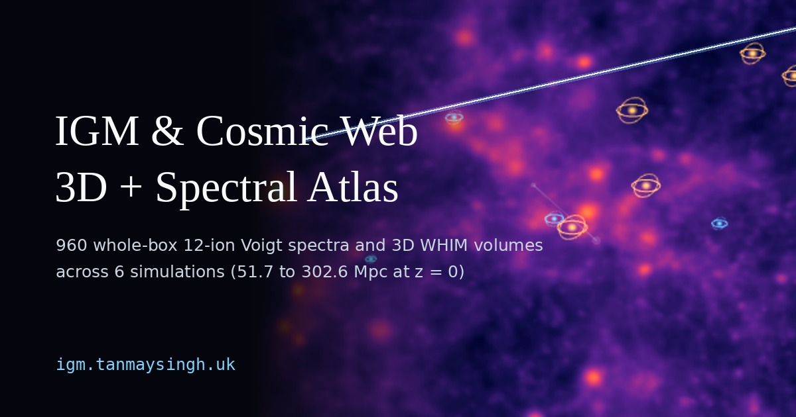

<p align="center">
  <a href="https://igm.tanmaysingh.uk/#tab=3d"></a>
</p>
<p align="center"><sub>The $z = 0$ Cosmic Web and Warm-Hot Intergalactic Medium (WHIM) rendered live in WebGL2 across 6 whole-box hydrodynamic simulations at <a href="https://igm.tanmaysingh.uk/#tab=3d">igm.tanmaysingh.uk</a>.</sub></p>

> [!NOTE]
> Part of the 4-portal **Cross-Scale Astrophysical Atlas Suite** spanning $2500\text{ AU}$ to $302.6\text{ Mpc}$ — open an [issue or feature request](https://github.com/tanmay-starslab/igm-atlas/issues) with ideas or feedback!

<h1 align="center">Seeing the Intergalactic Medium &amp; Cosmic Web</h1>

<p align="center"><b>Shine a quasar beam across 50 to 303 Mpc of the simulated universe and read the Ly&alpha; forest, WHIM filaments, and supercluster nodes it traverses.</b></p>

<p align="center">
  <a href="https://igm.tanmaysingh.uk/"><b>Launch the Live IGM &amp; Cosmic Web Atlas &rarr;</b></a>
  &nbsp;&middot;&nbsp;
  <a href="https://igm.tanmaysingh.uk/#tab=3d"><b>Open 3D Cosmic Web Stage &rarr;</b></a>
  &nbsp;&middot;&nbsp;
  <a href="https://igm.tanmaysingh.uk/igm/learn/how-a-spectrum-is-made/"><b>How a Spectrum is Made &rarr;</b></a>
</p>

<p align="center">
  <a href="https://igm.tanmaysingh.uk"></a>
  <a href="https://huggingface.co/datasets/tanmay-starslab/igm-atlas-data"></a>
  <a href="LICENSE"></a>
  <a href="https://creativecommons.org/licenses/by/4.0/"></a>
  <a href="https://www.tng-project.org/data/"></a>
</p>

Most of the baryons in the $z = 0$ universe do not live inside galaxies. They reside in the **Intergalactic Medium (IGM)**: a vast, gossamer network of photoionized **Ly$\alpha$ forest** sheets ($T \sim 10^{3.8\text{--}4.5}\text{ K}$), metal-enriched filament spines ($T \sim 10^{4.5\text{--}5.3}\text{ K}$), and shock-heated **Warm-Hot Intergalactic Medium (WHIM)** bridges ($T \sim 10^{5.3\text{--}6.7}\text{ K}$) linking massive galaxy clusters across tens to hundreds of megaparsecs.

This portal lets you fly through **six complete $z = 0$ cosmological simulation boxes** (**`SIMBA-100`**, **`CAMELS-IllustrisTNG-L50n512`**, **`TNG50-1`**, **`TNG100-1`**, **`TNG300-1`**, and **`Illustris-1`**, spanning **$51.7\text{ Mpc}$ to $302.6\text{ Mpc}$**) in 3D WebGL2 and inspect **960 whole-box 12-ion Voigt-profile absorption sightlines** (160 per simulation box) through any UV, EUV, or X-ray spectrograph you choose.

---

## Cross-Scale Astrophysical Atlas Suite ($2500\text{ AU} \to 302.6\text{ Mpc}$)

Every portal in the suite shares the same WebGL2 3D volumetric engine, 12-ion registry, in-browser Levenberg–Marquardt Voigt fitter, and top-bar cosmic scale switcher (`ISM | CGM | ICM | IGM`):

| Cosmic Scale Regime | Physical Extent | Finest Voxel Scale | Live Portal | GitHub Repository |
| :--- | :--- | :--- | :--- | :--- |
| **ISM** (Interstellar Medium &amp; Mixing Layers) | $2500\text{ AU} \to 1\text{ kpc}$ | $0.005\text{ pc}$ ($1\text{ AU}$) | [`ism.tanmaysingh.uk`](https://ism.tanmaysingh.uk) | [`tanmay-starslab/multiphase-ism`](https://github.com/tanmay-starslab/multiphase-ism) |
| **CGM** (Circumgalactic Medium) | $1\text{ kpc} \to 400\text{ kpc}$ | $11.7\text{ pc}$ (`L4`) | [`galaxies.tanmaysingh.uk`](https://galaxies.tanmaysingh.uk) | [`tanmay-starslab/cgm-atlas`](https://github.com/tanmay-starslab/cgm-atlas) |
| **ICM** (Intracluster Medium &amp; Clusters) | $15\text{ kpc} \to 8\text{ Mpc}$ | $117\text{ pc}$ (`L4` BCG core) | [`icm.tanmaysingh.uk`](https://icm.tanmaysingh.uk) | [`tanmay-starslab/icm-atlas`](https://github.com/tanmay-starslab/icm-atlas) |
| **IGM** (Intergalactic Medium &amp; Cosmic Web) | **$3.2\text{ Mpc} \to 302.6\text{ Mpc}$** | **$12.6\text{--}35.9\text{ kpc}$ (`L2` filament)** | **[`igm.tanmaysingh.uk`](https://igm.tanmaysingh.uk)** | **[`tanmay-starslab/igm-atlas`](https://github.com/tanmay-starslab/igm-atlas)** |

---

## Six Whole-Box $z = 0$ Cosmological Simulations &amp; Deep Links

Every simulation volume is deposited onto **three nested $256^3$ 3D volumetric grids** (`L0` full periodic box, `L1` $\text{Box}/4$ supercluster nexus, `L2` $\text{Box}/16$ inter-cluster WHIM filament bridge) paired with companion **3D galaxy starlight cubes (`S0..S2`)** and **160 whole-box THOR Voronoi sightlines**:

| Simulation Box | Hydro Solver &amp; Resolution | `L0` Full Box ($256^3$ Voxel) | `L1` Supercluster Nexus ($\text{Box}/4$, Voxel) | `L2` WHIM Filament Bridge ($\text{Box}/16$, Voxel) | Nexus $\log M_{200c}$ [$M_\odot$] | Direct Live Deep Links |
| :--- | :--- | :--- | :--- | :--- | :--- | :--- |
| **`SIMBA-100`** (`simba100_cosmic_web`) | GIZMO MFM $1024^3$ gas + $1024^3$ DM (snap 151) | **$147.1\text{ Mpc}$** ($574.6\text{ kpc}$) | **$36.8\text{ Mpc}$** ($143.7\text{ kpc}$) | **$9.19\text{ Mpc}$** (**$35.9\text{ kpc}$**) | $15.16$ | [Spectra](https://igm.tanmaysingh.uk/#g=simba100_cosmic_web) &middot; [3D Web](https://igm.tanmaysingh.uk/#g=simba100_cosmic_web&tab=3d) |
| **`CAMELS-L50`** (`camels_l50n512_cosmic_web`) | AREPO moving-mesh $512^3$ (`CV_0`, snap 090) | **$74.5\text{ Mpc}$** ($291.0\text{ kpc}$) | **$18.6\text{ Mpc}$** ($72.8\text{ kpc}$) | **$4.66\text{ Mpc}$** (**$18.2\text{ kpc}$**) | $14.60$ | [Spectra](https://igm.tanmaysingh.uk/#g=camels_l50n512_cosmic_web) &middot; [3D Web](https://igm.tanmaysingh.uk/#g=camels_l50n512_cosmic_web&tab=3d) |
| **`TNG50-1`** (`tng50_cosmic_web`) | AREPO MHD $2160^3$ gas cells (snap 099) | **$51.7\text{ Mpc}$** ($202.0\text{ kpc}$) | **$12.9\text{ Mpc}$** ($50.5\text{ kpc}$) | **$3.23\text{ Mpc}$** (**$12.6\text{ kpc}$**) | $14.29$ | [Spectra](https://igm.tanmaysingh.uk/#g=tng50_cosmic_web) &middot; [3D Web](https://igm.tanmaysingh.uk/#g=tng50_cosmic_web&tab=3d) |
| **`TNG100-1`** (`tng100_cosmic_web`) | AREPO MHD $1820^3$ gas cells (snap 099) | **$110.7\text{ Mpc}$** ($432.4\text{ kpc}$) | **$27.7\text{ Mpc}$** ($108.1\text{ kpc}$) | **$6.92\text{ Mpc}$** (**$27.0\text{ kpc}$**) | $14.89$ | [Spectra](https://igm.tanmaysingh.uk/#g=tng100_cosmic_web) &middot; [3D Web](https://igm.tanmaysingh.uk/#g=tng100_cosmic_web&tab=3d) |
| **`TNG300-1`** (`tng300_cosmic_web`) | AREPO MHD $2500^3$ gas cells (snap 099) | **$302.6\text{ Mpc}$** ($1182\text{ kpc}$) | **$75.7\text{ Mpc}$** ($295.5\text{ kpc}$) | **$18.9\text{ Mpc}$** (**$73.9\text{ kpc}$**) | $15.51$ | [Spectra](https://igm.tanmaysingh.uk/#g=tng300_cosmic_web) &middot; [3D Web](https://igm.tanmaysingh.uk/#g=tng300_cosmic_web&tab=3d) |
| **`Illustris-1`** (`illustris1_cosmic_web`) | AREPO hydro $1820^3$ gas cells (snap 135) | **$106.5\text{ Mpc}$** ($416.0\text{ kpc}$) | **$26.6\text{ Mpc}$** ($104.0\text{ kpc}$) | **$6.66\text{ Mpc}$** (**$26.0\text{ kpc}$**) | $14.67$ | [Spectra](https://igm.tanmaysingh.uk/#g=illustris1_cosmic_web) &middot; [3D Web](https://igm.tanmaysingh.uk/#g=illustris1_cosmic_web&tab=3d) |

---

## What You Can Explore

### 1. Three Nested $256^3$ Cosmic-Web Levels (`L0`, `L1`, `L2`) + 3D Galaxy Starlight (`S0..S2`)
- **`L0` / `S0` — Full Periodic Cosmological Box ($\pm L_{\text{box}}/2$, $51.7\text{--}302.6\text{ Mpc}$)**: Surveys the large-scale cosmic web of voids, sheets, filaments, and superclusters across the entire periodic domain.
- **`L1` / `S1` — Primary Supercluster Nexus ($\pm L_{\text{box}}/8 = \text{Box}/4$, $12.9\text{--}75.7\text{ Mpc}$)**: Zooms $4\times$ into the most massive supercluster node where multiple cosmic filaments converge and drive virial accretion shocks.
- **`L2` / `S2` — Inter-Cluster WHIM Filament Bridge ($\pm L_{\text{box}}/32 = \text{Box}/16$, $3.23\text{--}18.9\text{ Mpc}$)**: Zooms $16\times$ into the primary WHIM filament spine at **$12.6\text{--}35.9\text{ kpc}$ voxel resolution** (`TNG50-1` to `SIMBA-100`; $73.9\text{ kpc}$ in `TNG300-1`), resolving individual galaxy halos and feedback plumes embedded along intergalactic filaments.
- **18 Volumetric Fields + 5 Kinematic Views**: Inspect `nH`, `T`, `Z`, all 12 ion number/column densities (`HI`, `MgII`, `SiII`, `CII`, `SiIII`, `CIII`, `SiIV`, `CIV`, `NV`, `OVI`, `NeVIII`, `OVII`), and 3D peculiar velocity fields ($v_{\text{los}}$, $v_r$, $v_\phi$, $|v|$, $\sigma_{\text{los}}$) in both **Projected Column (`integral`)** and **THOR 1D/2D Transfer-Function (`volume`)** modes.

### 2. 960 Whole-Box THOR Voronoi Sightlines Across 12 UV / EUV / X-Ray Transitions
Each simulation box carries **160 sightlines** (960 total) organized by physically meaningful cosmic-web orientations:
- **Z-axis (`box Z`)**: Parallel to the simulation box $z$-axis across supercluster and filament planes.
- **XY-plane (`filament`)**: Slicing across the inter-cluster WHIM filament bridge in the $xy$-plane.
- **Oblique / 3D**: Reproducible 3D rays piercing voids, sheets, and filaments across impact parameters $b$ up to $150\text{ Mpc}$.
- **Live In-Browser Custom Ray Casting**: Pick any 3D start/end point or `(orientation, b, Φ)` geometry to trace a new 12-ion Voigt sightline directly through the 3D ion cubes in your browser via the Rust/WebAssembly kernel (`fast_viz.wasm`).

| Ion Transition | Rest $\lambda_0$ [Å] | $f_{\text{osc}}$ | Band | Primary Cosmic-Web &amp; IGM Phase Traced |
| :--- | :--- | :--- | :--- | :--- |
| **H I 1216** (Ly$\alpha$) | $1215.670$ | $0.416$ | UV | Diffuse photoionized Ly$\alpha$ forest sheets, filaments &amp; Lyman-limit nodes ($\log T \sim 3.8\text{--}4.5\text{ K}$) |
| **Mg II 2796** | $2796.352$ | $0.612$ | UV | Cool dense knots &amp; embedded dwarf/filament galaxy halos ($\log T \sim 4.0\text{ K}$) |
| **Si II 1260** | $1260.422$ | $1.180$ | UV | Cool metal-enriched filament cores &amp; embedded circumgalactic nodes |
| **C II 1335** | $1334.532$ | $0.129$ | UV | Cool/mildly ionized intergalactic clouds &amp; filament interfaces |
| **Si III 1206** | $1206.500$ | $1.630$ | UV | Photoionized metal-bearing Ly$\alpha$ forest filaments ($\log T \sim 4.2\text{--}4.6\text{ K}$) |
| **C III 977** | $977.020$ | $0.759$ | UV | Intermediate-ionization filament spines &amp; group outskirts ($\log T \sim 4.5\text{--}4.9\text{ K}$) |
| **Si IV 1403** | $1402.770$ | $0.255$ | UV | Photoionized &amp; interface gas along metal-enriched cosmic filaments |
| **C IV 1548** | $1548.187$ | $0.190$ | UV | Feedback-enriched filament spines &amp; AGN/wind-polluted IGM ($\log T \sim 4.8\text{--}5.1\text{ K}$) |
| **N V 1239** | $1238.821$ | $0.156$ | UV | Conductive &amp; shock-heated transition layers ($\log T \sim 5.1\text{--}5.4\text{ K}$) |
| **O VI 1032** | $1031.912$ | $0.133$ | UV | Cool-WHIM accretion shocks &amp; filament sheaths ($\log T \sim 5.3\text{--}5.7\text{ K}$) |
| **Ne VIII 770** | $770.409$ | $0.102$ | EUV | Warm-Hot Intergalactic Medium (WHIM) filament bridges ($\log T \sim 5.7\text{--}6.1\text{ K}$) |
| **O VII 21.6** | $21.6019$ | $0.696$ | X-ray | Hot WHIM &amp; supercluster virial shock boundaries ($\log T \sim 6.1\text{--}6.7\text{ K}$) |

---

## Scientific Methodology

1. **Exact 3D Voronoi/Delaunay Cell Ray-Tracing (THOR)**: All 960 library sightlines are traced through the native 3D Voronoi/Delaunay tessellation of the simulation gas particles/cells using digest-pinned **THOR** (`dataset_type=pointcloud_voronoi`, `driver_type=raytracer`; Byrohl &amp; Nelson 2025, arXiv:2507.11603), preserving exact cell boundaries and velocity gradients without grid-smearing before spectral synthesis.
2. **Photo-+Collisional Ionization (`CLOUDY c17.03 FG11 + Rahmati13`)**: Ion fractions are evaluated from **CLOUDY c17.03** (Ferland et al. 2017) tables under the **Faucher-Giguère (2011)** metagalactic UV+X-ray background with **Rahmati et al. (2013)** $\text{H\,I}$ self-shielding (`sfr_temperature = 1000 K`) and tracked simulation element abundances.
3. **FP64 Voigt Radiative Transfer (`SBI_CGM`) &amp; In-Browser Fitting**: Optical depths are synthesized at $0.5\text{ km s}^{-1}$ log-velocity spacing and resampled to $0.25\text{ km s}^{-1}$ native / $1\text{ km s}^{-1}$ web (`TNGS` v2 binary) grids. In your browser, spectra are convolved with a Gaussian LSF ($\text{FWHM} = c/R$, $R = 5{,}000\text{--}150{,}000$ UV/EUV, $100\text{--}5{,}000$ X-ray) and fitted on the fly in a Web Worker via Levenberg–Marquardt optimization seeded from `tngsight/vpfit.py` intrinsic catalogs and pruned by $\Delta\text{BIC}$.

---

## Bring Your Own Cosmological Volume &amp; Local Development

Convert any cosmological HDF5 snapshot (IllustrisTNG, SIMBA, CAMELS, EAGLE, Ramses, Gizmo, Enzo, Athena++) into a `tng50-viz/2` 3D cosmic-web bundle and sightline library:

```bash
# Build 3-level 256^3 cosmic-web cubes and 160-ray THOR Voigt catalogs
python scripts/build_igm_showcase.py --workers 16
python -m tngsight.vizpack validate docs/igm/data/viz

# Run the static site locally and execute the JS + Python test suites
(cd docs && python3 -m http.server 8000)   # open http://127.0.0.1:8000/igm/
python -m pytest tests
node tests/js/run_all.mjs
```

---

## Credits &amp; License

- **Simulations**:
  - **SIMBA-100** (`m100n1024_s50`, $147.1\text{ Mpc}$, $z = 0$): Davé et al. 2019, [MNRAS 486, 2827](https://doi.org/10.1093/mnras/stz937).
  - **CAMELS-IllustrisTNG-L50n512** (`CV_0`, $74.5\text{ Mpc}$, $z = 0$): Villaescusa-Navarro et al. 2021, [ApJ 915, 71](https://doi.org/10.3847/1538-4357/abf7ba).
  - **IllustrisTNG** (**TNG50-1** $51.7\text{ Mpc}$, **TNG100-1** $110.7\text{ Mpc}$, **TNG300-1** $302.6\text{ Mpc}$, $z = 0$): Nelson et al. 2019a, [ComAC 6, 2](https://doi.org/10.1186/s40668-019-0028-x); Pillepich et al. 2018, 2019; Springel et al. 2018; Marinacci et al. 2018; Naiman et al. 2018.
  - **Illustris-1** ($106.5\text{ Mpc}$, $z = 0$): Vogelsberger et al. 2014, [Nature 509, 177](https://doi.org/10.1038/nature13316); Genel et al. 2014.
- **Source Code**: MIT License ([`LICENSE`](LICENSE), © 2026 Tanmay Singh).
- **Derived Volumetric &amp; Spectral Atlases**: CC BY 4.0 ([`tanmay-starslab/igm-atlas-data`](https://huggingface.co/datasets/tanmay-starslab/igm-atlas-data)).
- **Explainer Audio**: Optional background music in *How an absorption spectrum is made* features *Hans Zimmer, Day One (Interstellar, 2014)* and *Beethoven, Symphony No. 7 in A major, Op. 92: II. Allegretto* (see `THIRD_PARTY_LICENSES`).
